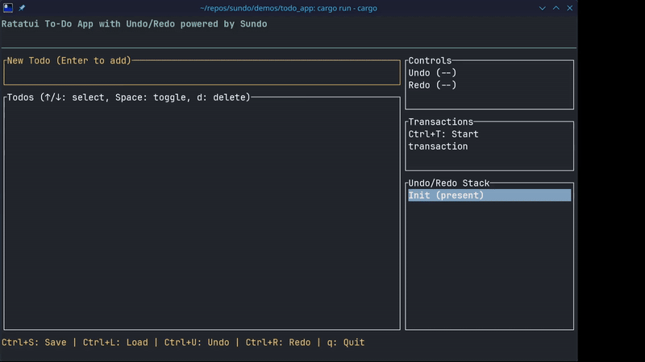

# Sundo Demos

This directory contains standalone demonstration applications showing various features of the sundo library.

## Running Demos

Each demo is a standalone Cargo project. Navigate to its directory and run:

```bash
cd basic-example
cargo run --release
```

**Note:** Memory-intensive demos should use `--release` for accurate measurements.

## Available Demos

### basic-example
Compares standard `UndoRedo<T>` with `PersistentUndoRedo<T>` for persistent data structures.

**Topics covered:**
- Standard undo/redo with Vec
- Persistent undo/redo with im::Vector
- im::HashMap usage
- Memory efficiency comparison

**Run:** `cd basic-example && cargo run`

---

### persistent-example
Deep dive into persistent data structures with detailed explanations.

**Topics covered:**
- im::Vector operations
- im::HashMap operations
- Structural sharing benefits
- Performance characteristics

**Run:** `cd persistent-example && cargo run`

---

### scoped-transaction
Demonstrates transaction patterns with automatic rollback.

**Topics covered:**
- RAII transactions
- Explicit commit
- Auto-rollback on error
- Exception-safe patterns
- Nested scopes

**Run:** `cd scoped-transaction && cargo run`

---

### builder-pattern
Shows history limit configuration and builder pattern usage.

**Topics covered:**
- UndoRedoBuilder API
- Count-based history limits
- Automatic pruning
- Use cases (editors, apps, embedded)
- Memory management

**Run:** `cd builder-pattern && cargo run`

---

### memory-limits
Demonstrates memory-based history limits using the MemoryFootprint trait.

**Topics covered:**
- MemoryFootprint trait implementation
- Memory-based pruning
- Combined count and memory limits
- Custom type memory estimation
- Built-in im:: type support
- Snapshot with memory info

**Run:** `cd memory-limits && cargo run`

---

### mem-performance
Comprehensive memory performance tests measuring allocation patterns and efficiency.

**Topics covered:**
- Memory usage tracking
- Rc sharing efficiency
- Vec vs im::Vector memory comparison
- Structural sharing benefits
- Transaction memory impact
- History memory overhead

**Run:** `cd mem-performance && cargo run --release`

**Note:** Use `--release` flag for accurate memory measurements.

---

### serialization-example
Shows how to serialize/deserialize undo/redo history without requiring serde.

**Topics covered:**
- Export history to snapshots
- Custom serialization formats
- Reconstruct from snapshots
- No serde dependency needed
- Full control over serialization

**Run:** `cd serialization-example && cargo run`

---

### delta-example
Shows how to compute deltas (diffs) between any two states in history.

**Topics covered:**
- Implementing Diffable trait for custom types
- Using peek_at() to access states without moving pointer
- Computing deltas between consecutive states
- Comparing arbitrary states
- Generating changelogs from deltas
- Audit trails and conflict resolution

**Run:** `cd delta-example && cargo run`

---

### todo_app
Complete TUI todo list application demonstrating real-world sundo usage.




**Topics covered:**
- Ratatui terminal interface
- PersistentUndoRedo with im::Vector
- Undo/redo for todo operations
- Transactions (batch operations)
- Save/load history to JSON
- Persistent state across sessions
- replace_current() for non-undoable state (navigation example)
- Status messages and UI feedback

**Run:** `cd todo_app && cargo run`

**Controls:**
- `Enter`: Add todo
- `↑/↓`: Navigate todos
- `Space`: Toggle completion
- `d`: Delete selected todo
- `Ctrl+U`: Undo
- `Ctrl+R`: Redo
- `Ctrl+T`: Start/End transaction
- `Ctrl+C`: Cancel transaction
- `Ctrl+S`: Save history
- `Ctrl+L`: Load history
- `q` or `Esc`: Quit

---

## Future Demos

These demos are planned for future development:

- **canvas-app** - Graphics canvas with state management

## Summary

Currently available: **9 demos** covering basic usage, persistent data structures, transactions, history limits, memory-based limits, memory analysis, serialization, delta computation, and a complete todo app.

## Contributing

Have an idea for a demo? Please open an issue or submit a PR!
